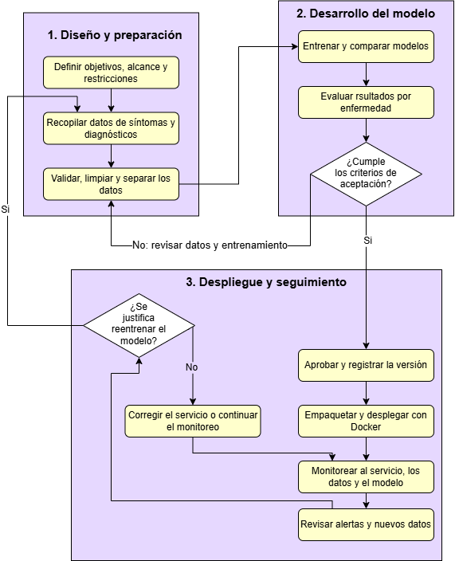

# Propuesta de pipeline de MLOps

## 1. Problema y alcance

Se propone un pipeline de MLOps para desarrollar un modelo de clasificación a partir de síntomas. La propuesta considera enfermedades comunes, con más registros disponibles, y enfermedades huérfanas, con menos casos documentados.
El modelo propuesto serviría como apoyo al personal médico. Para la segunda parte de la entrega se implementará una función simulada en Docker.

## 2. Diagrama general

**Figura 1. Pipeline de MLOps para un sistema de clasificación a partir de síntomas**

## 3. Explicación de las etapas

### Diseño y preparación

Se definen el objetivo, las variables de entrada y los criterios de aceptación.
Se recopilan registros autorizados con síntomas y diagnósticos confirmados.
Se revisan los valores faltantes y los duplicados, se protege la identidad de los pacientes y se separan los datos por paciente en conjuntos de entrenamiento, validación y prueba.
Los datos de entrada incluirían síntomas reportados, su duración y mediciones disponibles. 
Los diagnósticos confirmados en registros clínicos autorizados se usarían como etiquetas durante el entrenamiento y la evaluación.

### Desarrollo del modelo

Se entrenan y comparan modelos de clasificación. Para abordar el desbalance, se pueden probar pesos por clase durante el entrenamiento. Se evalúa el desempeño por enfermedad, ya que una buena exactitud global puede ocultar errores en clases con pocos casos. Si el modelo no cumple los criterios de aceptación, se revisan los datos y el entrenamiento.
Se usaría una regresión logística como referencia y se compararía con un bosque aleatorio. En un conjunto de prueba separado por paciente se medirían la precisión y la sensibilidad por enfermedad. 
Los criterios de aceptación se acordarían antes de evaluar. Si hay muy pocos casos de una enfermedad huérfana para estimar el desempeño con confianza, se recopilarían más casos antes de aprobar el modelo para esa enfermedad.

### Despliegue y seguimiento

La versión aprobada se registra, se empaqueta con Docker y se despliega como servicio. Se monitorean los errores, los tiempos de respuesta y los cambios en los datos de entrada. Cuando se obtienen diagnósticos confirmados, se comparan con las predicciones. Si la revisión justifica reentrenar, se vuelve a la etapa de datos y se evalúa la nueva versión antes de desplegarla.
Una alerta llevaría a revisar primero los datos, el servicio y el desempeño del modelo. Si se justifica reentrenar, la nueva versión tendría que superar los mismos criterios de aceptación antes de reemplazar a la anterior.
Durante todo el proceso se documentan las versiones de los datos, el código y el modelo para que los resultados puedan reproducirse.